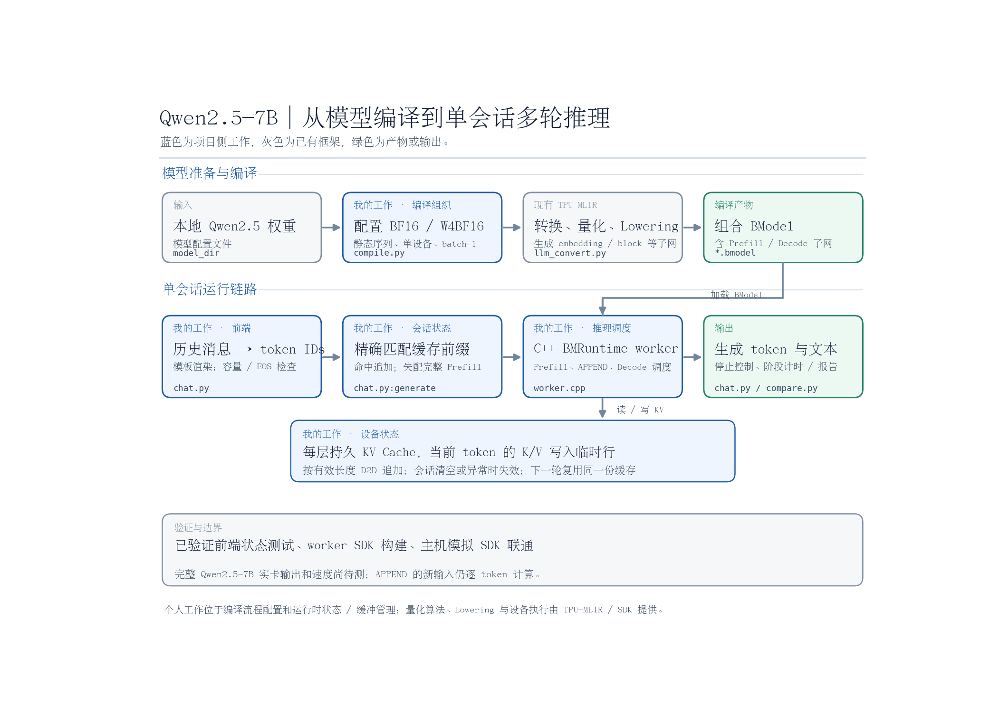
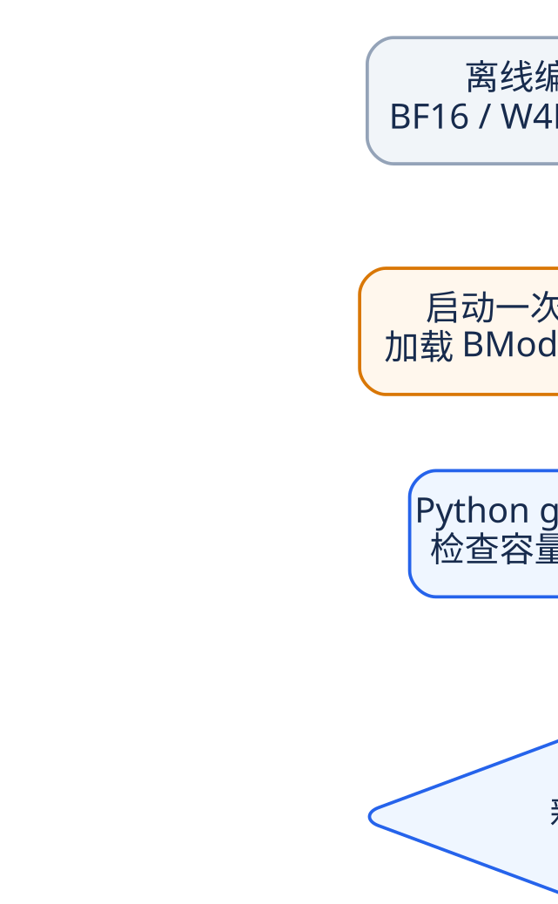
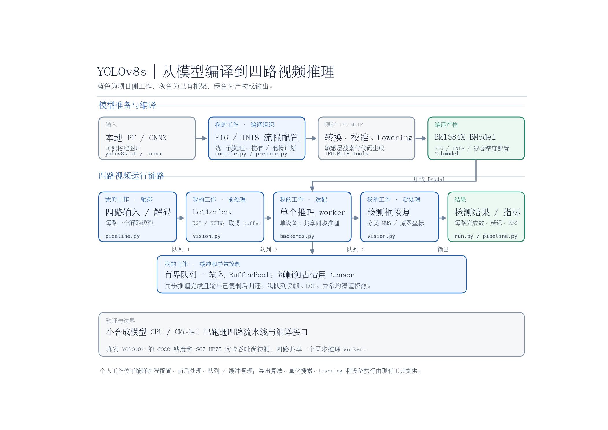
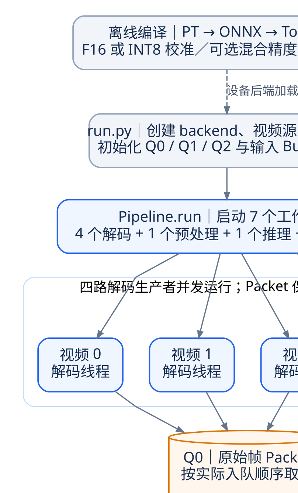

# Qwen2.5-7B 与 YOLOv8s 的 TPU-MLIR 部署

两个面向 BM1684X 的应用：Qwen2.5-7B-Instruct 多轮对话与设备 KV Cache 复用，YOLOv8s 四路视频检测与 F16/INT8 编译。每个应用运行在一个设备上，使用 `--device` 选择设备编号。

| 项目 | 配置与运行教程 | 主要入口 |
| --- | --- | --- |
| Qwen2.5-7B | [Qwen README](qwen2_5/README.md) | `compile.py`、`chat.py`、`worker.cpp` |
| YOLOv8s | [YOLO README](yolov8/README.md) | `compile.py`、`run.py`、`pipeline.py` |

## 1. Python 环境

使用 Ubuntu 22.04、Python 3.10。以下命令从本仓库根目录执行；已有可用 Python 环境时，可直接使用该环境。

```bash
python3.10 -m venv .venv
source .venv/bin/activate
python -m pip install -r requirements-dev.txt
export APP_ROOT="$PWD"
```

`requirements.txt` 是 CPU 检测依赖，`requirements-dev.txt` 额外提供测试与 COCO 评估依赖。Qwen tokenizer 另需 `transformers`；从 PT 导出 YOLO 时另需 `ultralytics`，见各项目教程。

## 2. 配置已有 TPU-MLIR

编译和 CModel 使用外部 TPU-MLIR 源码树及其已有 `install/`。配置下面两个变量即可，无需把应用复制进编译器目录。

```bash
export TPU_MLIR_ROOT=/data/tpu-mlir
export INSTALL_PATH="$TPU_MLIR_ROOT/install"

test -f "$TPU_MLIR_ROOT/python/tools/llm_convert.py"
test -f "$TPU_MLIR_ROOT/python/tools/model_deploy.py"
test -x "$INSTALL_PATH/bin/tpuc-opt"
```

路径换成自己的目录。自定义构建位置时，将 `INSTALL_PATH` 指向那个已有安装目录。编译入口会为子进程配置工具、Python bindings、离线模型选项与 CModel 库路径。执行编译的 Python 环境还需要 TPU-MLIR 自身依赖；可直接使用已能编译模型的终端或容器。

本项目使用的 TPU-MLIR 基线是 [`bfc75a3`](https://github.com/sophgo/tpu-mlir/tree/bfc75a37092eef81e7feb40960320bbbde446d84)。当前适配源码树布局；只有 wheel、缺少 `python/tools/` 的安装方式需要另行适配。

<details>
<summary>首次准备 TPU-MLIR 编译环境</summary>

已有可用构建可直接跳过。先按[该版本官方安装说明](https://github.com/sophgo/tpu-mlir/blob/bfc75a37092eef81e7feb40960320bbbde446d84/README_cn.md#-安装)进入开发容器，再准备源码与依赖：

```bash
git clone https://github.com/sophgo/tpu-mlir.git /data/tpu-mlir
cd /data/tpu-mlir
git checkout bfc75a37092eef81e7feb40960320bbbde446d84
python -m pip install -r requirements.txt
source ./envsetup.sh
./build.sh DEBUG
```

这是首次构建编译器的步骤。已有 `install/` 时，日常运行两个应用只需设置上面的变量；模型转换会生成新的 BModel。初始化环境可能下载工具链，模型入口使用已经存在的本地模型文件。

</details>

## 3. 先做无卡检查

CPU 流水线与 host 测试不需要 TPU-MLIR、预训练权重或视频文件。

```bash
cd "$APP_ROOT"
python -m pytest tests qwen2_5/tests yolov8/tests -q
python smoke.py --output-dir artifacts/smoke_cpu
```

`smoke.py` 现场生成一个微型 ONNX，检查四路各 8 帧全部完成且无丢帧。它只验证接口与流水线，不能用于报告真实 YOLOv8s 精度或设备吞吐。

配置好已有编译器后，可继续检查 ONNX → Top → Tpu → F16 BModel 与四路 CModel：

```bash
python smoke.py --cmodel --output-dir artifacts/smoke_cmodel
```

## 4. 配置真实模型与设备

- Qwen：准备本地 Qwen2.5-7B-Instruct 权重、配置与 tokenizer，按 [Qwen 教程](qwen2_5/README.md)生成 BF16/W4BF16 模型，并构建 C++ worker。
- YOLO：准备本地 YOLOv8s PT/ONNX、校准图片和视频，按 [YOLO 教程](yolov8/README.md)编译并修改四路输入配置。
- 实卡：使用匹配 BM1684X 的驱动与 Sophon SDK；在启动应用前让真实 SDK 的库优先加载，并设置 `USING_CMODEL=False`。CModel 与实卡分别使用各自的运行库环境。

## 5. 项目流程图

以下图示来自原“打印”文件夹；仓库保留整体框架 PNG、调度流程 SVG，以及可编辑 Mermaid 源文件。

### Qwen2.5-7B



<details>
<summary>展开 Prefill、APPEND、Decode 与 KV Cache 调度流程</summary>



[查看 SVG](docs/images/qwen-scheduling.svg) · [Mermaid 源文件](docs/images/qwen-scheduling.mmd)

</details>

### YOLOv8s



<details>
<summary>展开四路解码、有界队列、BufferPool 与同步推理调度流程</summary>



[查看 SVG](docs/images/yolov8-scheduling.svg) · [Mermaid 源文件](docs/images/yolov8-scheduling.mmd)

</details>

## 6. 文件与输出

```text
qwen2_5/              Qwen 编译、Python 对话、C++ worker 与测试
yolov8/               YOLO 编译、四路流水线、后端、配置与测试
tests/                共享工作流、COCO 评估和 IR 元数据测试
common.py             外部编译器环境、分阶段计划与执行日志
smoke.py              微型模型与四路 CPU/CModel 检查
evaluate_coco.py      COCO 评估
inspect_compilation.py 真实 MLIR 算子、切片与地址分析
docs/images/          两个项目的框架图、调度图及 Mermaid 源文件
```

模型权重、数据集、SDK、编译器构建、生成的 IR/BModel 和实验日志由本地环境提供，已通过 `.gitignore` 排除。编译入口默认只生成 `plan.json`，添加 `--execute` 才执行转换，输出建议统一放在 `artifacts/`。

真实 7B/YOLOv8s 权重的端到端精度、COCO mAP 与实卡性能需要在对应模型和设备上实测。图示及微型模型检查不作为这些指标的证明。
